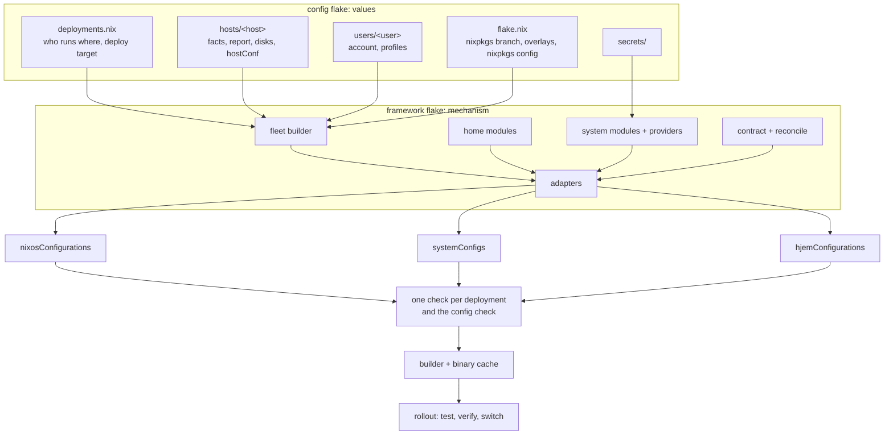

# Recommended architecture and plan

Companion to `AUDIT.md` (what was wrong) and `docs/spec.md` (what the code
must do, v4). This file says what I would build on from here, in which order,
and what I would leave alone.

## 1. Recommendation

Keep the shape the repository has now and stop adding machinery. The structure
is sufficient for 10+ mixed hosts; what is missing is operational: installing
hosts, rolling out, real keys, CI. Spend the next effort there.

Three structural changes were worth making, all small. They are done and
recorded in `docs/spec.md` (v4):

1. **Accounts belong to the user** (done). A login is declared once in
   `users/<user>/account.nix` and applied as the default on every NixOS host
   the user is deployed to; the hostConf keeps its own decisions: groups,
   extra keys, a guest password, and an override of a single value where it
   needs one.
2. **One updatable nixpkgs** (done). Both flakes name the `nixos-26.05`
   branch; the root lock pins its revision, and every host uses this one
   channel. Single newer packages come from `nixpkgs-unstable` as
   `pkgs.unstable.<name>`. One package policy (`framework.overlays`,
   `framework.nixpkgsConfig`) applies to NixOS, system-manager and standalone
   users. `nix run .#sync-framework-lock` keeps the framework's lock in
   agreement with the root's at every shared input path, and the `config`
   check, which uses the same comparison, fails when they drift.
3. **The spec lives in the repository** (done): `docs/spec.md`, versioned with
   the code it describes.

## 2. Target picture

## 3. Decisions

| Topic | Recommended | Not recommended | Revisit when |
|---|---|---|---|
| Repository shape | Framework stays a subflake of this repository | Separate framework repository now | A second config repository needs it; then tag releases and pin a tag |
| User layer delivery | Hjem: its NixOS module, and `hjem standalone` elsewhere | Home Manager next to Hjem | Hjem's standalone format changes incompatibly or the project stalls. The backend is confined to `adapters/hjem.nix` and `adapters/standalone.nix` |
| Non-NixOS system layer | `managed = "manual"` by default | system-manager on every foreign host | A foreign host needs a system service or account managed from here. Its option set is small and its firewall module is a mock |
| Capabilities on non-NixOS hosts | Declared by hand, plus a `doctor` script that checks them on the machine | Trusting the declaration | Not foreseen |
| Contract scope | Only what crosses from user to system, and host refusal | Routing system-internal needs through it; a generic contract framework | A kind has a consumer, a provider and a check |
| Secrets on NixOS | agenix + agenix-rekey, YubiKey master, 1Password recipient, offline key | A second secrets tool | Not foreseen |
| Secrets for standalone users | The 1Password agent and CLI on that machine | A decrypt backend in the user layer | Two standalone users need the same repo-managed secret |
| Installing a host | nixos-anywhere + disko + nixos-facter (`--generate-hardware-config nixos-facter`) | Hand-written hardware files for new hosts | Not foreseen |
| Hardware configuration | `hardware.facter.reportPath` on new installs; existing hosts keep their files | Switching running hosts to it without a reason | A host is reinstalled |
| Rollout | `nixos-rebuild test --target-host`, check SSH, then `switch`, driven by a short script over the inventory | An own deployment tool | About 15 hosts, or parallel rollout matters: colmena. Unattended remote hosts: deploy-rs for automatic rollback |
| nixpkgs | One stable branch for all hosts (`github:NixOS/nixpkgs/nixos-26.05`); single unstable packages as `pkgs.unstable.<name>` | A nixpkgs per deployment | A host needs a newer NixOS release as a whole. system-manager's branch must then move with it |
| Package policy | `framework.overlays` and `framework.nixpkgsConfig`, the same on NixOS, system-manager and standalone | `nixpkgs.overlays` or `nixpkgs.config` set per host | Not foreseen |
| Login accounts | Identity in `users/<user>/account.nix`, the default on every host; groups, extra keys, guest passwords and single overrides per host | An account block in every hostConf | A login name must differ per host (spec Q13) |
| CI | One builder; one job per check attribute (`nix-fast-build` or `nix build .#checks.<system>.<name>`) | One aggregate job | Not foreseen |
| Binary cache | harmonia on a server; hosts substitute from it | Every host building for itself | Not foreseen |
| Other architectures | Evaluate anywhere (already true); build on a native builder or with emulation on the builder | Cross-compiling systems | Not foreseen |
| Runtime tests | Two NixOS VM tests: workstation login path with Hjem files, server with a secret (owner and mode) | Relying on evaluation for runtime behaviour | Not foreseen |
| Services spanning hosts (backups, mesh VPN, monitoring) | Nothing until the second one exists | Roles on machines; a service engine now | Two such services are wanted: adopt clan, or instances with roles assigned by `tags` |
| Server baseline | The small own module; copy single settings from srvos when needed | Importing srvos wholesale (it decides sudo policy and more) | Not foreseen |
| Style | alejandra, statix, deadnix as checks | Formatting by convention | Not foreseen |

The packages named above (nixos-anywhere, disko, nix-fast-build, statix,
deadnix, colmena, deploy-rs) and the `services.harmonia` option exist in the
pinned nixpkgs; `/dev/kvm` is available in the guest for VM tests.

## 4. Plan

Each phase ends with something observable. Phases 1 to 3 are prerequisites
for real hosts; the rest can be reordered.

### Phase 0: done (commit `d99f9e8`)

Provider-based contract, typed inventory and facts, NixOS / system-manager /
standalone delivery, per-deployment checks, synthetic fleet, opt-in secrets
provider, reference workstation and server.

### Phase 1: foundations for real hosts (partly done)

Done (spec v4):

- `users/<user>/account.nix` (description, uid, shell, authorized keys,
  password) applied automatically where the user is deployed on NixOS; the
  hostConf adds groups, extra keys and a guest password, and may override a
  single value.
- nixpkgs as a branch reference in both flakes, one channel for every host;
  single newer packages as `pkgs.unstable.<name>`; one package policy
  (`framework.overlays`, `framework.nixpkgsConfig`) for NixOS, system-manager
  and standalone users; `sync-framework-lock` and the `config` check keep the
  framework's lock in agreement with the root's, path by path.
- Spec moved to `docs/spec.md`.

Left:

- `deploy.targetHost` (and optional `buildHost`) per deployment in the
  inventory.
- statix and deadnix checks; formatter run once.

Exit: a new NixOS host needs `facts.nix`, `default.nix` and one inventory
line, with no account text, and `nix flake update nixpkgs` moves every host
(both met); every deployment states its target, and the lint checks pass
(open).

### Phase 2: first real NixOS server

- Disk layout with disko in `hosts/<host>/disks.nix`.
- Install with nixos-anywhere, generating `facter.json`; enable
  `hardware.facter.reportPath` for this host.
- Key-only SSH; no password hash.
- Rollout script: build, `test` on the target, confirm SSH, `switch`.
- Exit: the server was installed from this repository and rebuilt once through
  the script.

### Phase 3: secrets with real keys

- YubiKey identity stub, 1Password recipient, offline key; set
  `framework.secrets`; `hostKey` for each NixOS host.
- First consumer: account passwords through `hashedPasswordFile`.
- NixOS VM test asserting owner and mode of a decrypted secret.
- Written procedures: lost YubiKey, reinstalled host, compromised host,
  retiring a host.
- Exit: no secret-derived value in the store on real hosts; one rekey done and
  one recovery rehearsed with the offline key.

### Phase 4: real workstations

- Desktop and laptop as real hosts with their own reports and overrides.
- NixOS VM test: greeter starts the compositor session; Hjem files exist and
  belong to the user.
- Exit: both run from this repository; the `desktop`/`server` references for
  the libvirt guest are kept only as test targets or removed.

### Phase 5: non-NixOS machines

- The Arch workstation as a `manual` host; `hjem standalone switch` on it.
- `doctor` script generated from the host's declared capabilities.
- Build-time check running `hjem standalone switch --manifest` into a
  temporary home, so a Hjem upgrade that breaks linking fails in CI.
- Exit: switch and rollback done on the real machine; `doctor` passes there.

### Phase 6: CI and cache

- Builder with one job per check; harmonia cache; hosts configured to use it.
- Scheduled `nix flake update` and `nix run .#sync-framework-lock`, with the
  checks as gate.
- Exit: a push builds every deployment; a rollout downloads instead of
  building.

### Phase 7: services across hosts (only when needed)

- Decide between clan and own instances when the second multi-host service is
  wanted. Host facts already keep tags on machines, and nothing assigns roles
  to machines, which is the shape both use.

### Phase 8: framework repository (only when needed)

- Split out when a second config repository exists; version it; the config
  flake pins a tag and keeps running the framework checks against its own
  lock.

## 5. What I would not build

- A nixpkgs per deployment.
- A generic contract or dependency framework; more capability kinds than have
  consumers.
- A secrets backend for standalone users.
- A deployment tool beyond a short script.
- Machine-level roles or a service engine before two multi-host services
  exist.
- A program-per-flake split.

## 6. Risks and what guards against them

| Risk | Guard |
|---|---|
| Hjem is young and its standalone CLI is new | Pinned revision; backend in two adapter files; the Phase 5 build-time check |
| system-manager must match the nixpkgs release | One nixpkgs for all hosts; its branch is updated together with nixpkgs |
| A capability declared by hand on a foreign host does not exist | `doctor` script on the machine; until then treat the declaration as documentation |
| A remote rebuild cuts off access | `test` before `switch`; a reboot returns to the previous generation |
| Loss of the YubiKey | 1Password recipient and offline key; rehearsed in Phase 3 |
| Old ciphertext stays readable to an old key | Rotation means changing the credential; procedure written in Phase 3 |
| Evaluation time grows with the fleet | Checks are per deployment and can run as separate jobs; measure at 10 hosts before changing anything |
| The framework's lock drifts from the root's, so its checks test other revisions than the deployed ones | `sync-framework-lock` after every update; the `config` check fails on drift |
| An input stops following the root's `nixpkgs` and builds from another one | The `config` check resolves every `nixpkgs` edge in the root lock and names the input paths that lead elsewhere |
| An unstable package does not fit the stable base | Taken one package at a time, never a whole host; the check of the deployment that uses it builds it |
| A config flake overrides its own check outputs (forces `flake.checks = { }` or `perSystem.checks = { }`): its hosts are exported with an empty check set, and `nix flake check` passes while running nothing | Accepted limit: the guards catch mistakes, not deliberate overrides. `systems` is validated, but exported check outputs cannot be, because such a guard would itself be an output. Mitigation: a reviewer reads the diff to the outputs block |
| Documentation drifts from code | Spec in the repository; README commands are the check commands |
